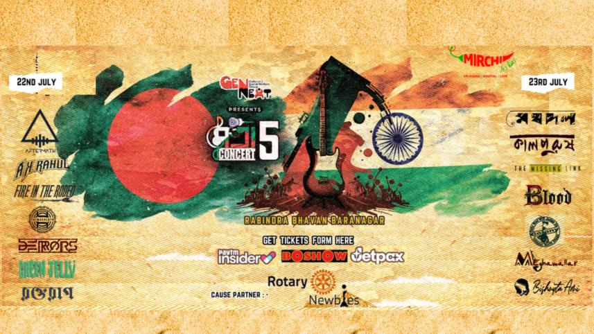

# 🎸 Aftermath (আফটারম্যাথ)

[](https://github.com/BD-Band-Archive/BD-Band-Music) [](#) [](#) [](#)

<p align="center">
  
</p>

## 🌟 About the Band

> "Founded in Dhaka in 2007, **Aftermath** is one of Bangladesh's premier alternative rock and grunge acts, renowned for their crushing guitar riffs, gritty vocals, and introspective poetic lyricism. Their hard-hitting sound and passionate songwriting have made them a cornerstone of modern Bengali rock."

---

## 📑 Discography Index

1. [Jed (জেদ) (2021)](#1-jed)
2. [Singles & Standalone Releases](#2-singles)

---

<a id="1-jed"></a>
## 1. Jed (জেদ) (2021)

- **Artist:** Aftermath
- **Release Year:** 2021
- **Audio Quality:** Lossless FLAC (16-bit / 44.1 kHz)

<p align="center">
  
</p>

### 📖 About the Album
Released on March 14, 2021, *Jed* ("Tenacity / Defiance") is Aftermath's monumental debut studio album. Masterfully engineered with crushing distorted guitars, soaring vocal hooks, and deeply emotive lyrical themes, the record established Aftermath as a formidable force in modern Bengali alternative rock. Landmark tracks include *"Hoongkar"*, *"Utshorgo"*, *"Dhoa"*, and *"Matir Roud"*.

### 🎵 Tracklist (One-Tap Download)

- [**Aftermath - Dhoa**](https://media.githubusercontent.com/media/BD-Band-Archive/Aftermath/master/Jed/Aftermath%20-%20Dhoa.flac?download=true) &nbsp; [](https://media.githubusercontent.com/media/BD-Band-Archive/Aftermath/master/Jed/Aftermath%20-%20Dhoa.flac?download=true)
- [**Aftermath - Hoongkar**](https://media.githubusercontent.com/media/BD-Band-Archive/Aftermath/master/Jed/Aftermath%20-%20Hoongkar.flac?download=true) &nbsp; [](https://media.githubusercontent.com/media/BD-Band-Archive/Aftermath/master/Jed/Aftermath%20-%20Hoongkar.flac?download=true)
- [**Aftermath - Matir Roud (Bonus Track)**](https://media.githubusercontent.com/media/BD-Band-Archive/Aftermath/master/Jed/Aftermath%20-%20Matir%20Roud%20%28Bonus%20Track%29.flac?download=true) &nbsp; [](https://media.githubusercontent.com/media/BD-Band-Archive/Aftermath/master/Jed/Aftermath%20-%20Matir%20Roud%20%28Bonus%20Track%29.flac?download=true)
- [**Aftermath - Odhikar**](https://media.githubusercontent.com/media/BD-Band-Archive/Aftermath/master/Jed/Aftermath%20-%20Odhikar.flac?download=true) &nbsp; [](https://media.githubusercontent.com/media/BD-Band-Archive/Aftermath/master/Jed/Aftermath%20-%20Odhikar.flac?download=true)
- [**Aftermath - Onnogaan**](https://media.githubusercontent.com/media/BD-Band-Archive/Aftermath/master/Jed/Aftermath%20-%20Onnogaan.flac?download=true) &nbsp; [](https://media.githubusercontent.com/media/BD-Band-Archive/Aftermath/master/Jed/Aftermath%20-%20Onnogaan.flac?download=true)
- [**Aftermath - Ospriho**](https://media.githubusercontent.com/media/BD-Band-Archive/Aftermath/master/Jed/Aftermath%20-%20Ospriho.flac?download=true) &nbsp; [](https://media.githubusercontent.com/media/BD-Band-Archive/Aftermath/master/Jed/Aftermath%20-%20Ospriho.flac?download=true)
- [**Aftermath - Tumi**](https://media.githubusercontent.com/media/BD-Band-Archive/Aftermath/master/Jed/Aftermath%20-%20Tumi.flac?download=true) &nbsp; [](https://media.githubusercontent.com/media/BD-Band-Archive/Aftermath/master/Jed/Aftermath%20-%20Tumi.flac?download=true)
- [**Aftermath - Upohaash**](https://media.githubusercontent.com/media/BD-Band-Archive/Aftermath/master/Jed/Aftermath%20-%20Upohaash.flac?download=true) &nbsp; [](https://media.githubusercontent.com/media/BD-Band-Archive/Aftermath/master/Jed/Aftermath%20-%20Upohaash.flac?download=true)
- [**Aftermath - Utshorgo**](https://media.githubusercontent.com/media/BD-Band-Archive/Aftermath/master/Jed/Aftermath%20-%20Utshorgo.flac?download=true) &nbsp; [](https://media.githubusercontent.com/media/BD-Band-Archive/Aftermath/master/Jed/Aftermath%20-%20Utshorgo.flac?download=true)

### 🖼️ Album Artwork

| | |
| :---: | :---: |
| <br><sub><b>1. Front Cover</b></sub> |  |

### 💿 CD Ripper & Preservation Credit
- **Preserved & Ripped by:** Official Lossless Master Archive / Exact Audio Copy (EAC Secure Rig)
- **Source:** Original Physical CD / Cassette Lossless Audio Archive

---

<a id="2-singles"></a>
## 2. Singles & Standalone Releases

- **Artist:** Aftermath
- **Release Year:** Standalone Releases
- **Audio Quality:** Lossless FLAC (16-bit / 44.1 kHz)

<p align="center">
  
</p>

### 📖 About the Album
A curated collection of standalone studio singles and collaborative releases by Aftermath, featuring groundbreaking tracks such as *"Moho"* (2019) and *"Biplobir"*.

### 🎵 Tracklist (One-Tap Download)

- [**Aftermath - Moho**](https://media.githubusercontent.com/media/BD-Band-Archive/Aftermath/master/Singles/Aftermath%20-%20Moho.flac?download=true) &nbsp; [](https://media.githubusercontent.com/media/BD-Band-Archive/Aftermath/master/Singles/Aftermath%20-%20Moho.flac?download=true)
- [**Biplobir - Aftermath Bangladesh**](https://media.githubusercontent.com/media/BD-Band-Archive/Aftermath/master/Singles/Biplobir%20-%20Aftermath%20Bangladesh.flac?download=true) &nbsp; [](https://media.githubusercontent.com/media/BD-Band-Archive/Aftermath/master/Singles/Biplobir%20-%20Aftermath%20Bangladesh.flac?download=true)

### 🖼️ Album Artwork

| | |
| :---: | :---: |
| <br><sub><b>1. Front Cover</b></sub> | <br><sub><b>2. Aftermath - Biplobir</b></sub> |
| <br><sub><b>3. Aftermath - Moho</b></sub> |  |

### 💿 CD Ripper & Preservation Credit
- **Preserved & Ripped by:** Official Lossless Master Archive / Exact Audio Copy (EAC Secure Rig)
- **Source:** Original Physical CD / Cassette Lossless Audio Archive

---

### 💾 Git LFS & Downloading Audio
All audio tracks in this repository are managed via **Git LFS** (Large File Storage).
- **One-Tap Direct Download:** Click either the track title or the green download button next to any song to instantly save the lossless FLAC file to your device.
- **To clone the complete discography locally with all FLAC files:**
  ```bash
  git lfs install
  git clone https://github.com/BD-Band-Archive/Aftermath.git
  ```

---

### 🤝 Contribution & DMCA Notice
All songs and archival materials in this repository were collected and curated from various internet sources, physical CD rips, and public community archives for cultural preservation and historical documentation.

- **Contributions:** If you have physical CD or cassette rips in lossless FLAC format, missing booklet/inlay scans, or tracklist metadata corrections, contributions and pull requests are warmly welcome!
- **DMCA / Copyright Notice:** If this repository contains your copyrighted or DMCA-protected files and you wish to have them removed, please contact:
  - **Email:** [maniruzzamanmridul@gmail.com](mailto:maniruzzamanmridul@gmail.com)
  
  Please provide the specific track, album, or file details, and the requested material will be reviewed and removed as soon as possible.

---

### 🙏 Special Thanks & Gratitude
Heartfelt gratitude to **Shohail Ibne Mahbub (XTR)** for his monumental passion and dedication in keeping Bangladeshi band music alive. Through his archival project [**Bangla CD Covers**](https://banglacdcovers.blogspot.com/), he has painstakingly collected, preserved, and scanned original physical CDs and cassette tapes, ensuring that the legacy, artwork, and history of Bangladesh's rock and band movement remain preserved for generations of music lovers.
